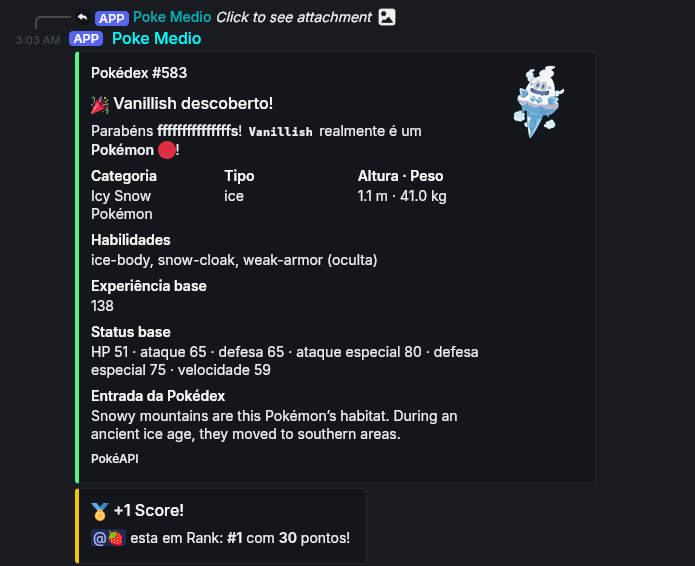
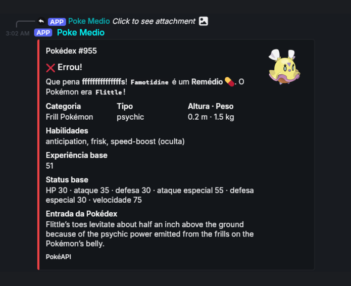

# PokeMedio

A Discord mini-game about Pokémon, medicine, and quick guesses. Play solo in a channel, build your score, and compare ranks with your server.

## Screenshots

<p align="center">
  
  
</p>

## Game modes

- **Classic:** Decide whether the name belongs to a Pokémon or a medicine.
- **Find the Pokémon:** Choose the Pokémon from a list of four names.
- **Ranks:** Earn points for correct answers and check your rank or the top ten players.

Correct and revealed Pokémon answers can include Pokédex artwork, type, abilities, measurements, base stats, and a Pokédex entry from PokéAPI.

## Commands

| Command | Description |
| --- | --- |
| `/play mode: Classic` | Start a classic round. |
| `/play mode: Find the Pokémon` | Find the Pokémon among four choices. |
| `/rank` | View your score and rank. |
| `/top` | View the top ten players. |

## Setup

**Requirements:** Node.js 18.17 or newer, Yarn 1, and a Discord application/bot.

1. Install dependencies:

	```sh
	yarn install
	```

2. Create your local environment file from the example:

	```sh
	cp .env.example .env
	```

	Open `.env` and replace the placeholders with your Discord bot token and application ID. `USERNAME` is optional and defaults to `Poke Medio`.

3. Register slash commands:

	```sh
	yarn register
	```

4. Start the bot:

	```sh
	yarn start
	```

For development with automatic restarts, run `yarn dev`. To run under PM2, use `yarn pm2`.

On first startup, PokeMedio populates its local SQLite database using PokéAPI and OpenFDA. The bot needs network access to both services during the initial sync. Keep `.env` private and never commit your bot token; `.env` is ignored by Git.

## Built with

- [discord.js](https://discord.js.org/) for Discord interactions
- [PokéAPI](https://pokeapi.co/) for Pokémon data and artwork
- [OpenFDA](https://open.fda.gov/) for medicine names
- SQLite via `better-sqlite3` for game items and scores
- [Winston](https://github.com/winstonjs/winston) for logging

## License

This project is released under the ISC license. See [LICENSE](LICENSE).
